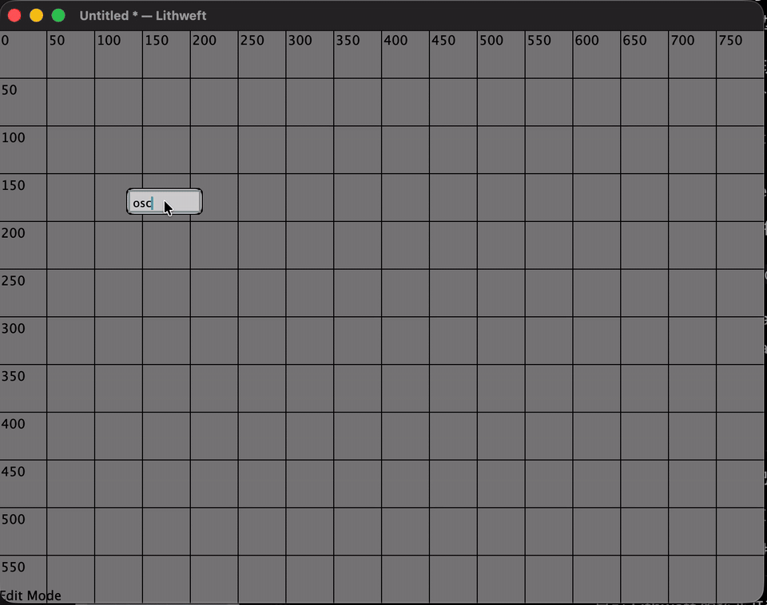

# Lithweft

A Max/MSP-like node-based audio platform prototype, built with C++ and JUCE through conversations with ChatGPT.



**Status: archival experiment. No maintenance is promised.**

## About

Lithweft began in late 2023 as an experiment initiated and directed by
Liu Hao, exploring a Max/MSP-like visual programming environment for audio.

It was developed through sustained conversations with ChatGPT. The process
involved distinct but overlapping contributions.

Liu Hao set the project's direction and supplied its goals, core concepts,
and design ideas, along with the continuing judgment, evaluation, and
aesthetic decisions that shaped it. This included work at the framework
level. For the basic building block of the system (what Max calls an
object, including objects implemented as externals, and Lithweft calls a
block or node), Liu Hao proposed ideas such as the inheritance relationships,
class and data-type design,
interfaces, and data-type checking. Liu Hao also read and modified the code
directly, examined how the mechanisms worked, and returned with revisions
and new requests.

ChatGPT proposed architectural and implementation approaches, generated and
revised the code, and helped work through problems that arose. Because
implementing a design requires making concrete structural decisions, this
also carried some framework- and rule-setting work of its own.

These contributions were intertwined rather than separable, and the block
framework is cited only as one example of a much larger body of judgment
and design work on both sides. The project does not attempt to attribute
every individual design decision or insight to one side.

The prototype includes node creation, UI controls, message and audio connections, and dynamically loaded blocks. Extensions were never completed. This repository preserves the experiment and makes its source available for others to study or fork.

Usability, stability and compatibility are not guaranteed. Issues and pull requests may go unanswered or unmerged. Community development is welcome through forks under the license.

## Timeline

- **Late 2023:** the original experiment began.
- **Early 2024:** further audio and UI experiments; original source-date comments are retained.
- **October 2026:** restored macOS builds, added patch saving/loading, fixed operator aliases, removed developer-specific paths, and prepared the archive under the name Lithweft.

This source includes the 2026 preparation changes; it is not an untouched 2023 snapshot. Publication dates are recorded by the actual Git history and release, without backdating the original experiment.

## Build

Verified with **JUCE 7.0.4, C++17, Xcode 26.1.1 and macOS 26 on Apple Silicon**. The build targets macOS 13+. Intel Macs and other operating systems have not been tested.

Install Xcode, then run from the repository root:

```sh
mkdir -p .deps
git clone --depth 1 --branch 7.0.4 https://github.com/juce-framework/JUCE.git .deps/JUCE
bash Tools/Archive/build.sh Debug
bash Tools/Archive/check.sh
```

To use an existing JUCE 7.0.4 SDK:

```sh
JUCE_DIR="/path/to/JUCE-7.0.4" bash Tools/Archive/build.sh Debug
```

Open `build/archive/Debug/Lithweft.app`. Its 15 block libraries are bundled inside the app; copy the whole app to retain them. Replace `Debug` with `Release` for a Release build. Builds use local ad-hoc signing and are not notarized. This archive distributes source; no official installer is provided.

To run directly from Xcode after installing JUCE, open `Lithweft/Builds/MacOSX/Lithweft.xcodeproj`, select **Lithweft - App → My Mac**, and press **⌘R**. Block libraries are built and bundled automatically. See [build details](docs/BUILD.md) for SDK setup and directory overrides.

## Try a patch

Choose **File → Open Patch** and open [Examples/arithmetic.lithweft](Examples/arithmetic.lithweft). Click the upper number, enter a value and press Return; the lower number displays the input plus two. This example produces no audio and needs no external files.

- Double-click empty canvas space to create a node, entering an expression such as `number`, `osc~ 440` or `/ 100`.
- Press **⌘E** to switch between editing and performance modes.
- Press **⌘S** to save, **⌘O** to open, **⇧⌘S** to save as, or **⌘N** to create a new patch.

New patches use `.lithweft`. Existing `.maxpatch` files from this prototype can still be opened; this does not imply compatibility with Cycling '74 Max patch files. See [patch file details](Lithweft/PATCH_FILES.md).

## Prototype limitations

Patches preserve the graph, layout and supported UI values, but do not embed external audio files or live/transient audio state. The `buffer` node loads WAV files through an explicit `read <path>` message. Audio processing, WAV parsing and timing remain experimental; the build and persistence checks do not establish production audio reliability.

## License

Author-written project code is licensed under **GNU AGPL version 3 (AGPL-3.0-only)**; see [LICENSE](LICENSE). JUCE and its dependencies retain their own licenses. This archive uses JUCE **7.0.4**, with its GPLv3/ISC or commercial licensing terms, rather than substituting the terms of a newer JUCE release. See [third-party notices](THIRD_PARTY_NOTICES.md) for the pinned version and license references.

## Author

**Liu Hao** (also written as **Hao Liu** in given-name-first order) · [liuhao-art.com](https://liuhao-art.com)

Independent experiment; not affiliated with or endorsed by Cycling '74, OpenAI or the JUCE authors.
